# Tenon

A 3D modeler in the push/pull tradition, written in Rust: draw a shape, pull it into a solid,
and keep going. Tenon runs as a desktop app on macOS, Windows and Linux, in a browser tab, and
headless, and every edit the window can make is also a command that scripts and AI agents can
send.

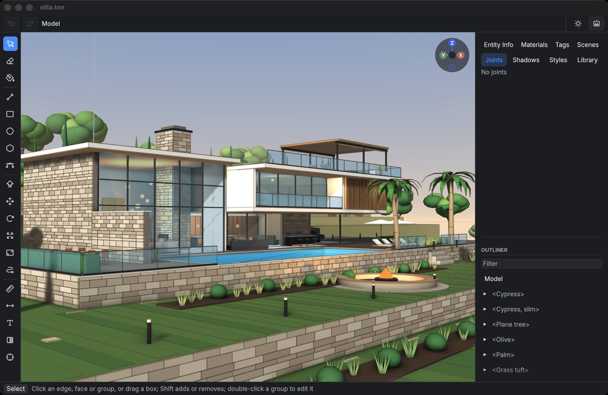

Every image on this page was made by Tenon itself: the window above is a screenshot, and the
renders below come from the scripts in [`clients/python/examples`](clients/python/examples),
which build each model through the agent API and render it with `render_view`.

## Architecture: a hillside villa

[`villa.py`](clients/python/examples/villa.py) builds the house in the window above in about
two seconds, about 3,300 objects in all. It has a double-height stone and glass living
pavilion and a bedroom volume cantilevered 5.5 m over the veranda and pool. On top is a roof
terrace under a slatted pergola. The walls are coursed ashlar with timber fins and frameless
glass balustrades. Retaining walls terrace the slope, and the site has an infinity pool, a
fire pit and a carport. Inside is a furnished interior: a floating stair, a kitchen, a dining
room for ten and a bedroom. At dusk, glowing pendants, cove strips, pool lights, bollards and
tree uplights light the scene:

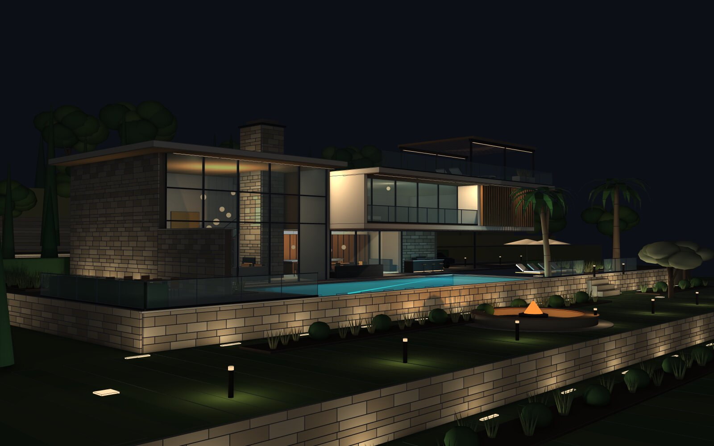

| | |
|---|---|
| 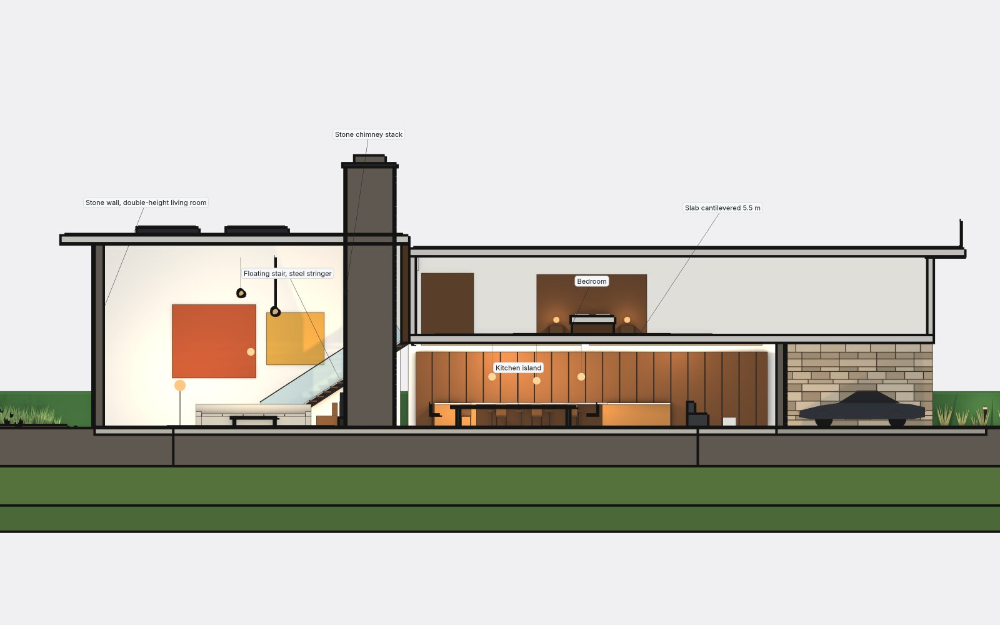 | 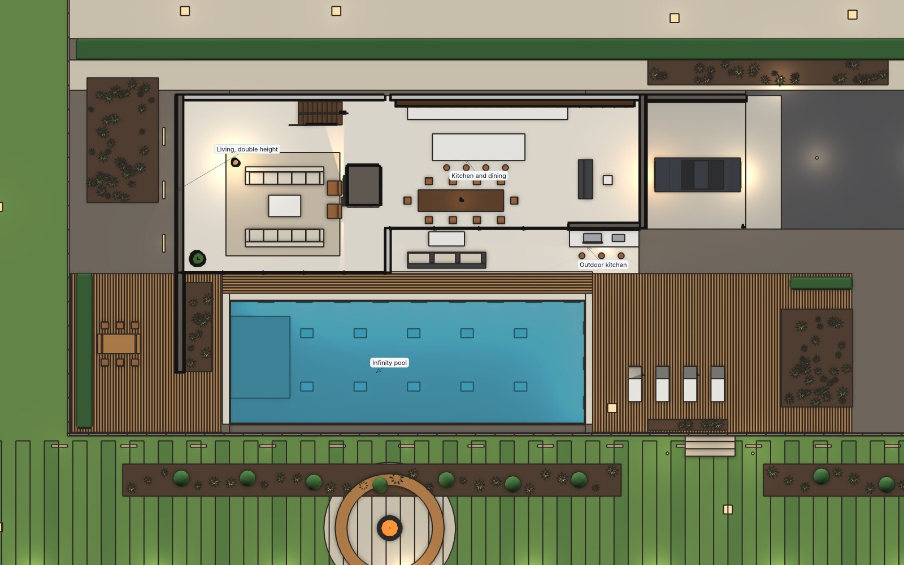 |
| A section plane through the living room, kitchen and cantilever | The same model cut as a floor plan |

## Mechanical engineering: a working V6

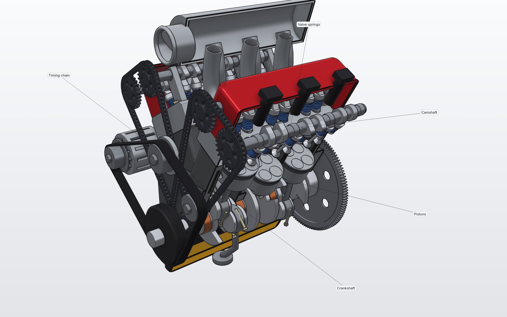

[`v6_engine.py`](clients/python/examples/v6_engine.py) builds a cutaway 60-degree V6 in about
four seconds: bores, water jacket, ports, I-beam rods, a counterweighted crank and helical valve
springs from primitives, solid booleans, fillets, chamfers, Follow Me sweeps, radial arrays and
chains copied along a path.

It is not just a picture. Every moving part sits on a joint: the crank is revolute, each piston
prismatic, the camshafts are coupled 1:2 to the crank, and all 24 valves follow their cam lobes.
Drive the crank and the whole engine moves:

<p align="center">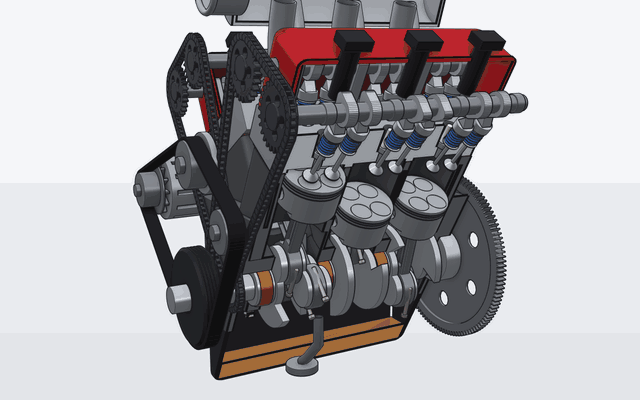</p>

[`v6_cycle.py`](clients/python/examples/v6_cycle.py) turns it through a full 720 degree cycle
and writes a report measured from the model itself:

```
bore            93.45 mm  (measure round on cylinder 1's wall)
stroke          86.00 mm  (piston joint travel, top to bottom dead centre)
displacement    590 cc per cylinder, 3.539 L for 6 cylinders
compression     11.2 : 1
engine          214.6 kg, centre of gravity (0.110, 0.004, 0.071) m
firing order    1-2-3-4-5-6
moving parts interfering (among the pairs measured): 0
```

Masses come from material densities, the bore from a least-squares fit of the faceted wall, and
the interference result from sweeping every joint through the cycle and checking each pair of
moving parts.

## Industrial robotics: a six-axis work cell

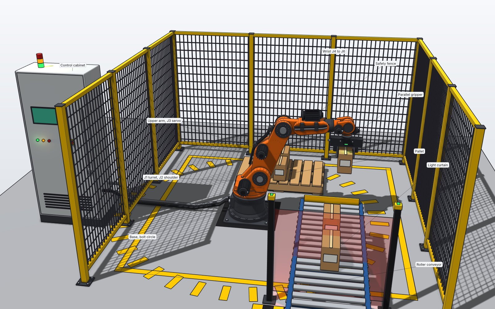

[`robot_cell.py`](clients/python/examples/robot_cell.py) builds a palletising cell around a
six-axis arm: hollow cast housings with filleted edges, finned servo motors, harmonic-drive
covers with bolt circles, cable packs swept along paths, and a parallel gripper whose fingers
are coupled to move together. Around it: a roller conveyor, cartons, a pallet, mesh safety
fencing, a light curtain and a control cabinet with a signal tower.

<p align="center">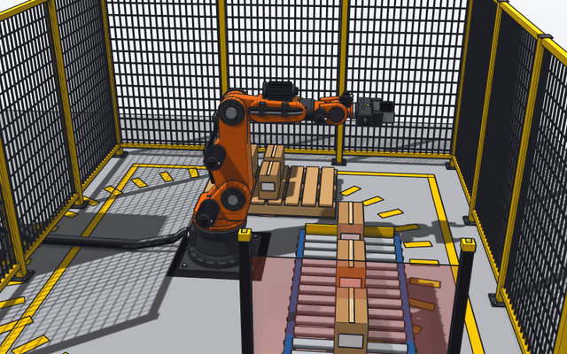</p>

The arm runs a pick-and-place cycle computed by inverse kinematics, and the script checks
every pose for collisions with the fence, conveyor and cartons. Joint limits come from sweeping
each axis until the arm hits itself:

```
J1 axis to tool centre point       1.897 m
arm, J1 to the fingers           203.8 kg   (centre of gravity 0.296, -0.018, 0.902 m)
J1 swing against the cell: overlaps with the cell: none
  nearest approach to the fence    360.6 mm
```

| | |
|---|---|
| 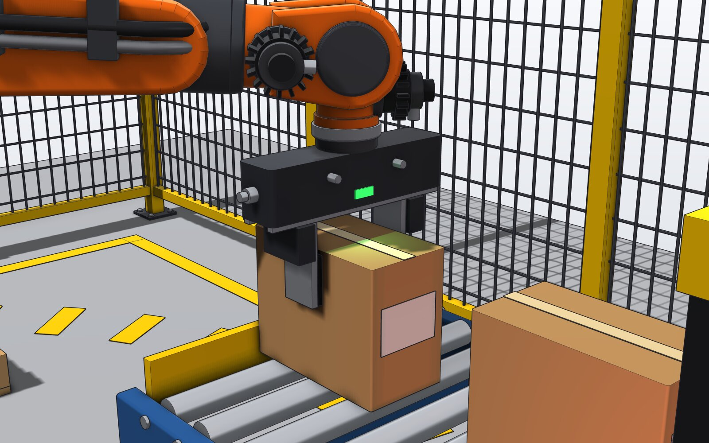 | 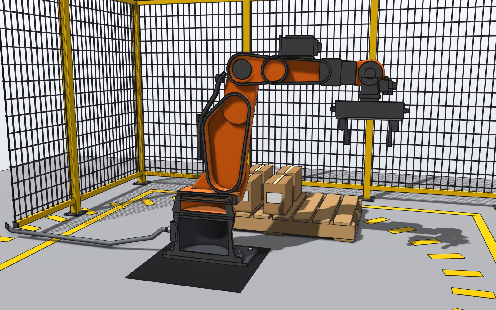 |
| The wrist and gripper | A section through the arm: the castings are hollow shells |

## Power transmission: a planetary gearbox

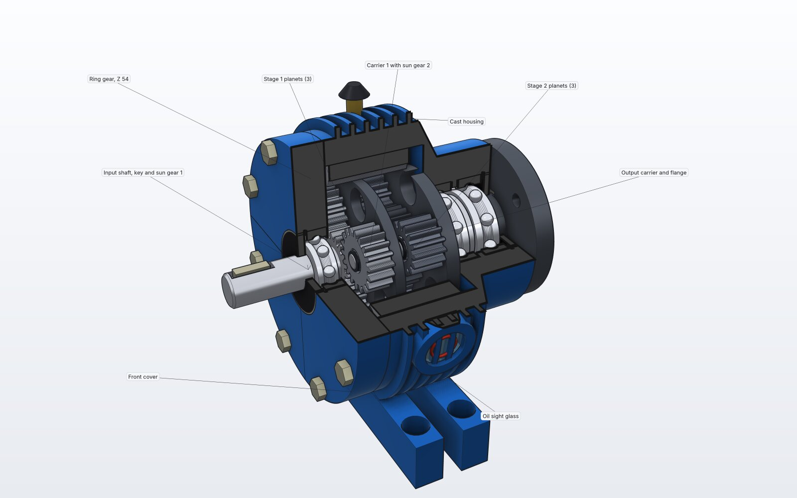

[`gearbox.py`](clients/python/examples/gearbox.py) builds a two-stage planetary reducer. The
involute teeth are generated in Python and extruded, and the ring's internal teeth are a
gear-shaped cutter subtracted from a bar. Around the gears: ball bearings with grooved races,
needle rollers, bronze bushings, keys, seals, circlips, a bolted cover and a finned housing
with feet, a breather and an oil sight glass. A per-part section cuts away the housing and
leaves the moving parts whole.

<table>
<tr>
<td width="50%">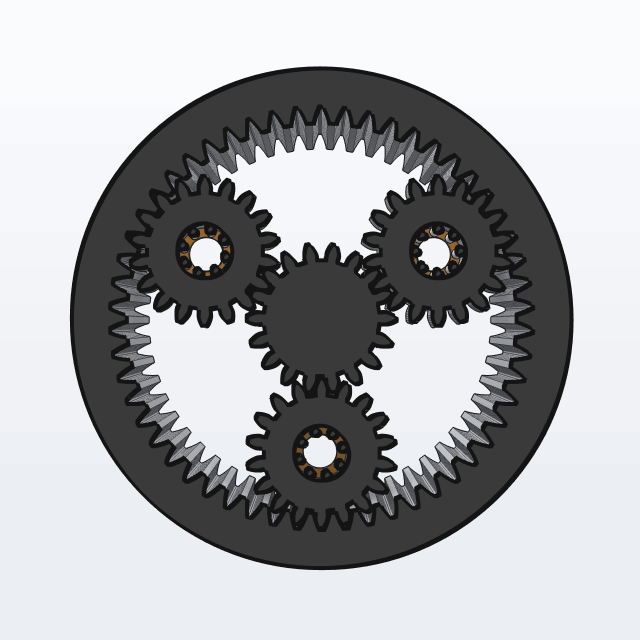</td>
<td width="50%">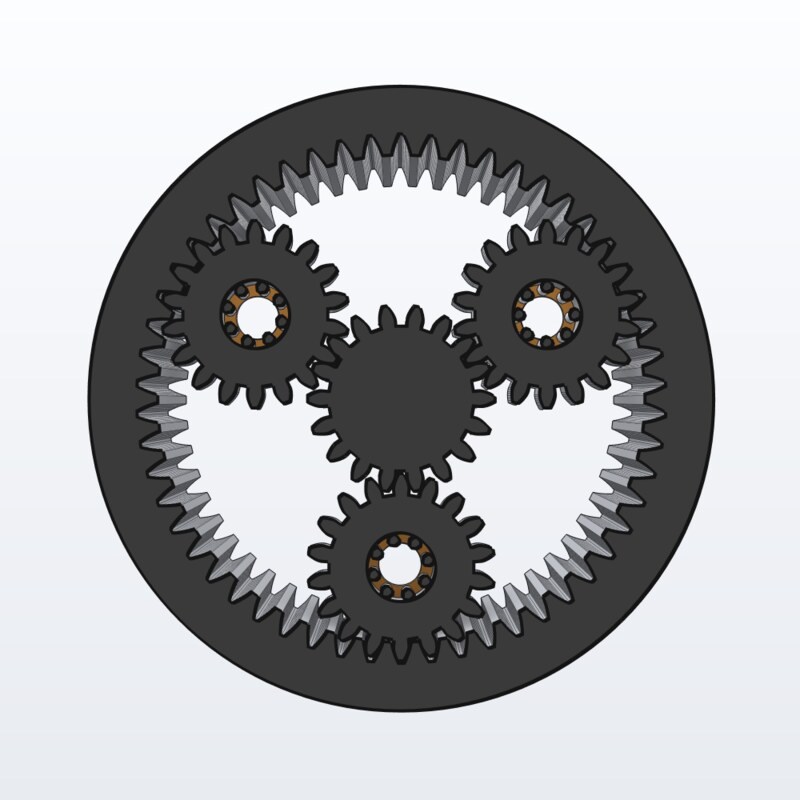</td>
</tr>
</table>

Every shaft, carrier and planet is on a joint, coupled at ratios taken from the tooth counts.
Driving the input checks the arithmetic in the model:

```
stage 1                   sun 18, 3 planets of 18, ring 54     ratio 4.0000
stage 2                   sun 24, 3 planets of 15, ring 54     ratio 3.2500
driven                    input turned 260.0 deg: output reads 20.0000 deg, ratio 13.0000
whole gearbox             7.12 kg, rotating assembly 1.62 kg
overlapping pairs         0
planet 1.1 / ring         0.037 mm clearance
```

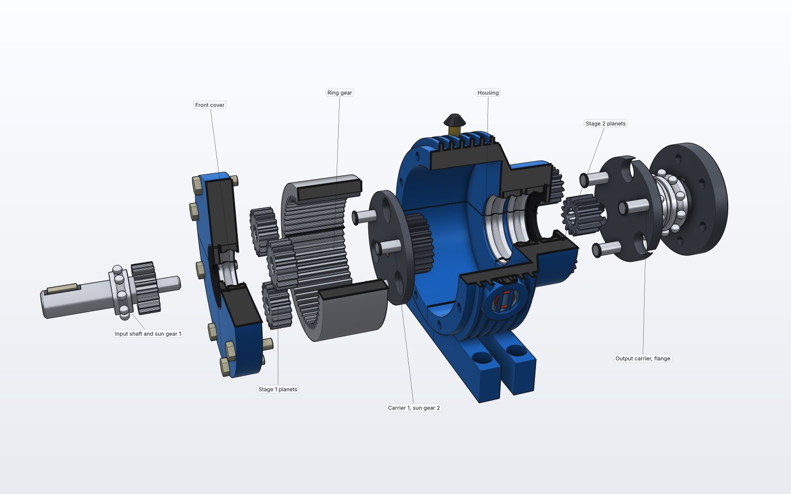

## Timber framing: a pegged oak barn

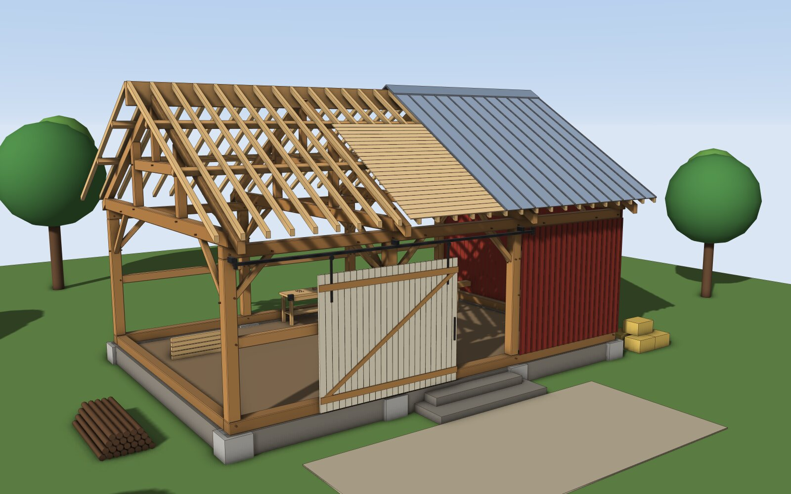

The project is named after the mortise-and-tenon joint, so it had to build one.
[`barn.py`](clients/python/examples/barn.py) raises an 8 x 12 m frame on four bents: posts,
sills, tie beams, plates, girts, queen posts, collars, knee braces, principal rafters with
birdsmouths, purlins and a ridge. Every mortise and peg hole is cut with `solid_subtract`,
every tenon is fused on with `solid_union`, and about 100 oak pegs hold it together. Cladding
and roofing stop part-way so the frame stays visible.

| | |
|---|---|
| 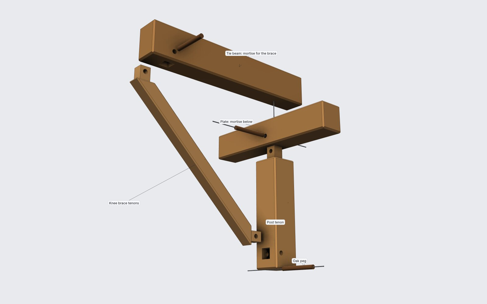 | 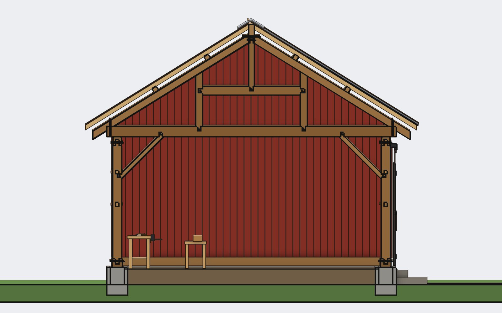 |
| One joint, exploded | A section through a bent: the tenons and pegs sit in their mortises |

The script also writes a timber schedule from the `cut_list` query:

```
Member                     Count  Section (mm)   Length (mm)  Volume (m3)
Tie beam                       4  300 x 220             8300        2.191
Post                           8  260 x 260             3570        1.931
Sill                           2  300 x 250            11660        1.749
Principal rafter               8  204 x 160             5390        1.407
...
Total (bounding boards)      174                                   14.147
```

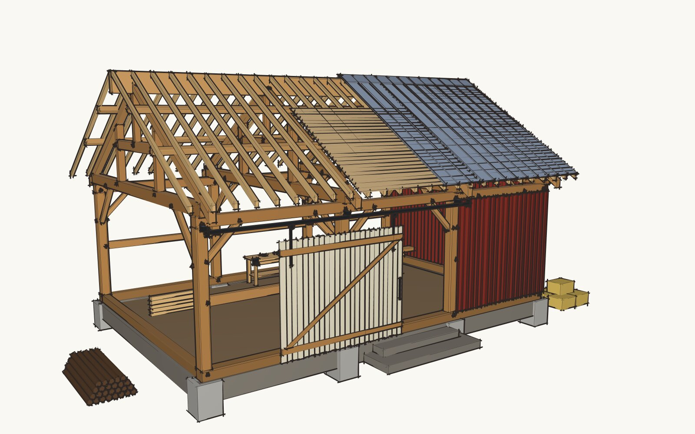

## Scale: a city in a few batches

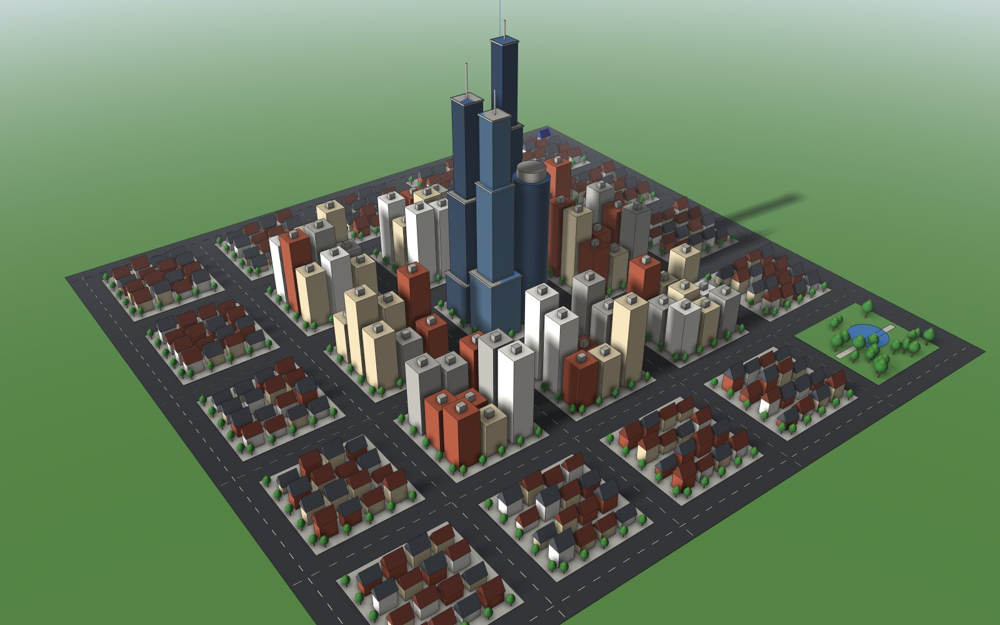

[`city.py`](clients/python/examples/city.py) builds a 5 x 5 block city (roads with lane
markings, towers with setbacks, houses with gable roofs, a park with a pond, hundreds of trees
from one component) in a handful of atomic batches, and renders it with sun shadows and
distance fog in a few seconds.

## What it can do

**Drawing and editing**
- Line, Rectangle, Rotated Rectangle, Circle, Arc, Polygon and Freehand tools with inference
  snapping (endpoints, midpoints, edges, faces, axes, guides) and typed exact values.
- Push/Pull, Offset, Follow Me, Move, Rotate, Scale, Flip, Eraser, Paint Bucket, Tape Measure
  and Protractor guides.
- Groups and components (edit one, update all), Make Unique, outliner, tags, hide and unhide,
  cut, copy and paste in place, Intersect Faces.
- Dimensions, leader labels, screen text and 3D text.

**Solids**
- Primitives: box, cylinder, tube, cone, sphere, torus, prism, helix.
- Union, subtract, intersect, trim, split and outer shell.
- Fillet and chamfer edges, Model Health with Make Solid to repair parts that are not closed.
- Volume, mass, centre of gravity and inertia; exact distance and angle measurement; a cut list.

**Mechanisms**
- Revolute, prismatic, cylindrical, ball and fixed joints with limits.
- Gear and chain couplings between joints, cam followers.
- Interference and clearance checks, and sweeps of a joint over a range to find collisions.
- Scenes that store camera, visibility and part positions, with animated transitions.

**Rendering and output**
- Day, night and studio lighting; sun position from latitude, longitude, date and time.
- Materials with color, textures, opacity, metalness, roughness and glow.
- Styles: profiles, sketchy edges, edge colors by material or axis, fog, sky, ambient occlusion.
- X-ray, hidden geometry, parallel and perspective projection, standard views.
- Print and PDF at an exact scale (tiled across sheets), SVG line drawings, PNG renders.

**Files**
- Native `.tnn` files, with autosave and crash recovery.
- SketchUp `.skp`: import (2017 and later) and export (2017 format).
- Import OBJ, STL, glTF/GLB, COLLADA (`.dae`) and PNG/JPEG images.
- Export OBJ, STL, glTF and 3MF (for 3D printing, with colors and textures).
- A personal component and material library in a folder you choose.

**Everywhere**
- macOS, Windows and Linux desktop packages (`.dmg`, `.msi`, AppImage).
- A WebAssembly build that runs in a browser with WebGPU or WebGL2 ([docs/web.md](docs/web.md)).
- Open on Phone: a QR code sends an end-to-end encrypted, read-only copy of the model to a
  phone's browser over the local network ([docs/phone.md](docs/phone.md)).

## Built for agents

Every command in the window is part of a JSON-RPC API over a socket (a named pipe on Windows),
or stdin/stdout when headless: about 200 commands and queries, each described by a JSON Schema
from `describe`. Agents can also see what they are doing: `render_view` returns a PNG,
`pick` and `infer` say what is under a pixel and what a click would snap to, and `tool_input`
drives the real drawing tools with mouse and keyboard events.

```bash
cargo run --release -p app -- --headless --stdio          # JSON-RPC on stdin/stdout
cargo run --release -p app -- --mcp                       # an MCP server for Claude and other clients
cargo run --release -p app -- --mcp --live SOCKET         # drive a running window and watch the agent work
```

A batch is one undo step, all or nothing, and later commands can refer to what earlier ones
made:

```json
{"jsonrpc": "2.0", "id": 1, "method": "batch", "params": {"commands": [
  {"type": "add_rectangle", "corner": [0, 0, 0], "opposite": [4, 3, 0]},
  {"type": "push_pull", "face": "$0:f0", "distance": 2.5}
]}}
```

Edits made through the API are labelled as agent steps in the undo history, and
`--api-root DIR` limits the files an agent may read or write. See
[docs/agent-api.md](docs/agent-api.md), [docs/mcp.md](docs/mcp.md) and the dependency-free
[Python client](clients/python/README.md).

## Build and run

Needs a Rust toolchain (the version used in `.github/workflows/ci.yml`).

```bash
cargo run --release -p app                 # the window
cargo run --release -p app -- model.tnn    # open a file
cargo test                                 # the test suite
```

Platform notes: [Linux](docs/linux.md), [Windows](docs/windows.md),
[web](docs/web.md), [packaging](docs/packaging.md), [testing](docs/testing.md).

To regenerate the renders on this page:

```bash
cargo build --release -p app
export TENON_APP=target/release/app
python3 clients/python/examples/v6_engine.py --out /tmp/shots
python3 clients/python/examples/v6_cycle.py --out /tmp/shots
python3 clients/python/examples/villa.py --out /tmp/shots
python3 clients/python/examples/robot_cell.py --out /tmp/shots
python3 clients/python/examples/gearbox.py --out /tmp/shots
python3 clients/python/examples/barn.py --out /tmp/shots
python3 clients/python/examples/city.py --out /tmp/shots
```

## Credits

The `.skp` reader is adapted from [openskp-rs](https://github.com/hakkokimkr/openskp-rs). Third
party licences are listed in [THIRD_PARTY_NOTICES.md](THIRD_PARTY_NOTICES.md).
